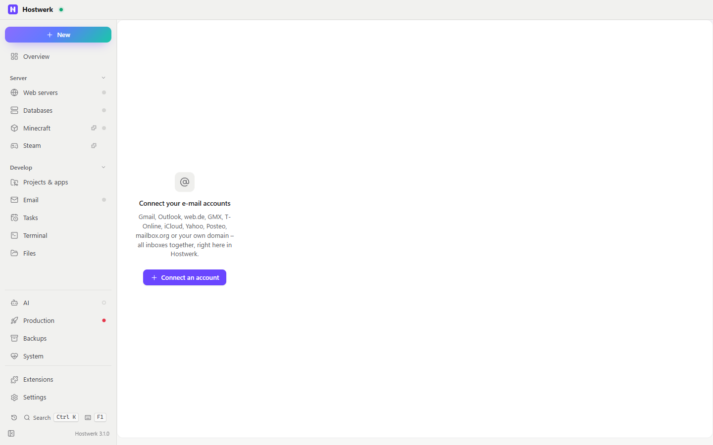

# E-mail accounts

Your mailboxes from Gmail, Outlook, web.de, GMX, T-Online, iCloud, Yahoo, Posteo, mailbox.org or your own domain right inside Hostwerk: all inboxes together, folders, conversations, search, safe reading that blocks trackers and flags phishing, writing with signatures, templates and undo send, rules, push via IMAP IDLE and offline reading. Hostwerk finds the settings itself – without its own provider list.

[Deutsch](README.de.md) · An official [Hostwerk](https://github.com/Passimoritz/hostwerk-public) extension (native extension, Hostwerk 3.0 or newer)



## What it does

- **Where:** *E-mail → Mailboxes* (next to the mail catcher and the mail server), a dashboard tile and the full page under *Extensions → Open*. No own sidebar entry.
- **Connect an account:** type the address – Hostwerk looks up the servers itself (see below), shows where it found them, hints like “switch on IMAP in your web settings first” or “use an app password”, tests the login and only then saves it. Manual entry for everything else. The **mail catcher** (IMAP on) and mailboxes of the **Mail server** extension connect with one click.
- **Reading:** all inboxes together or per account, IMAP folders with their roles (SPECIAL-USE: inbox, sent, drafts, archive, spam, trash – also localised names), conversations (Message-ID chain, otherwise subject), filters (unread, starred, attachments), search on the server (IMAP SEARCH, Gmail’s own search syntax with Gmail) plus the local cache, “load more”.
- **Safe display:** the mail runs in a sandboxed frame without scripts and with its own content security policy; HTML is cleaned (no scripts, forms, frames, event handlers, `javascript:`); images from the internet only on click (“always for this sender” possible); tracking pixels are always removed and counted; links show their target and ask when the visible text points to another domain.
- **Phishing hints** without lists: SPF/DKIM/DMARC from the topmost `Authentication-Results` (set by your own provider), a display name with a foreign address/domain, reply-to elsewhere, link text ≠ link target, bare IP addresses, look-alike domains (punycode), risky attachments (`.exe`, `.js`, macros …).
- **Attachments:** preview for images, PDF, text, audio and video; download; save to a folder (one or all); `.eml` of a mail, `.mbox` of a whole folder.
- **Writing:** reply, reply all, forward (with attachments), formatted or plain text, signature and aliases per account, contacts suggested from your mails, templates, important/read receipt, attachment reminder, drafts on the server (saved every 30 s), **undo send** (default 10 s), outbox with retry when a mail can’t go out. Sent mails go into “Sent” (not with Gmail, which does that itself).
- **Sorting:** mark read/unread, star, archive (folder created if missing), spam, move (also by dragging onto a folder), delete into the trash (from the trash for good, after asking), bulk actions, right-click menus everywhere.
- **Push instead of polling:** one IMAP IDLE connection per account watches the inbox; reconnects on its own with a growing pause (2 s … 5 min); after a wrong password only every 30 min, so the provider doesn’t lock the account. Notifications bundled (several mails within 20 s = one), quiet hours, per account switchable; unread counts in the list and on the tile.
- **Rules:** sender/recipient/subject/newsletter/attachment → move, read, star, archive, trash, no notification. No forwarding by rule (on purpose – a favourite of attackers).
- **Unsubscribe** via `List-Unsubscribe` – one-click (RFC 8058) without opening a website, otherwise the link or a prepared mail.
- **AI help** (optional, off by default): summarise, translate, “what do they want?” for one mail at a time through Hostwerk’s AI assistant (`host.ai.quick`). Only after you allowed it; with a local model nothing leaves the PC.
- **Offline:** recently opened and the newest inbox mails are kept (default 300 MB, least recently opened go first); lists and mails show from the cache when there is no connection; Hostwerk’s offline mode is respected (no connections, sending waits).
- **Backup:** accounts (secrets encrypted), rules, templates and settings show up in Hostwerk’s backup centre (daily snapshot, 10 kept, restore and external backup). Mails stay on the mail servers.
- **Keyboard:** J/K, Enter, R, A, F, E, #/Del, S, U, X, C, /, Esc in the list; Ctrl+Enter sends, Ctrl+S saves the draft; global Ctrl+Alt+M (write) and Ctrl+Alt+I (open) – changeable under *Settings → General → Shortcuts*.

## Finding the settings – without a list to maintain

The order is the same as Thunderbird’s; the sources are kept up to date by the providers and by Mozilla:

| Step | Where | Example |
|---|---|---|
| 1 | Autoconfig of the provider: `https://autoconfig.<domain>/mail/config-v1.1.xml`, `https://<domain>/.well-known/autoconfig/…` | own domains, many hosters |
| 2 | Mozilla’s ISPDB `https://autoconfig.thunderbird.net/v1.1/<domain>` (only the domain is sent) | gmail.com, web.de, gmx.de, t-online.de, icloud.com, yahoo.com, posteo.de, mailbox.org, outlook.com |
| 3 | MX of your domain → domain of the mail hoster → ISPDB there | your own domain at Google Workspace, Microsoft 365, IONOS … |
| 4 | DNS SRV (RFC 6186/8314): `_imaps._tcp`, `_imap._tcp`, `_submissions._tcp`, `_submission._tcp` | self-hosted |
| 5 | Microsoft Autodiscover (POX) incl. redirect | Exchange |
| 6 | Guess with a probe (`imap.`/`mail.`/`smtp.` + port): only the greeting, never credentials | small hosters |

OAuth endpoints and scopes also come from the ISPDB (`<oAuth2>`) or from the provider’s OpenID description – not from Hostwerk.

## Signing in – honestly, per provider

| Provider | What works | Notes |
|---|---|---|
| Gmail / Google Workspace | **App password** (needs 2-step verification) | OAuth with your own Google Cloud client (“Desktop app”) works too – but as long as the app is in Google’s “Testing” state, Google ends the sign-in after 7 days; a published app with the Gmail scope needs Google’s verification. The app password is the practical way. |
| Outlook.com / Hotmail / Live | **OAuth only** | Microsoft switched off password logins for IMAP/SMTP. Register a free app once in Microsoft Entra (“personal Microsoft accounts”, platform “Mobile and desktop”, redirect `http://localhost/api/x/mail-accounts/pub/oauth`) and paste its client ID. |
| Microsoft 365 (business) | OAuth (own app, admin consent may be needed) | the tenant can disable SMTP AUTH – then sending doesn’t work. |
| web.de, GMX | Password, app password with 2FA | IMAP must be switched on in the web settings first – Hostwerk shows the link from the ISPDB. |
| T-Online | the separate *e-mail password* | not the login password of the customer centre. |
| iCloud | **App-specific password** | created at appleid.apple.com. |
| Yahoo, AOL | **App password** | |
| Posteo, mailbox.org | Password (app password with 2FA at mailbox.org) | |
| Own domain / hoster | Password | settings via autoconfig, SRV, MX or Autodiscover. |
| Mail catcher, own mail server | one click / mailbox password | local, without encryption only on this PC or in the home network. |

Why no built-in OAuth app? Google and Microsoft only give OAuth to registered apps. A Hostwerk-wide registration would need constant upkeep (verification, security assessment, deadlines) and could be blocked at any time – exactly the maintenance this extension avoids. With your own app ID you depend on nobody. Tokens are refreshed automatically (also rotating refresh tokens).

## Security

- Passwords, client secrets and refresh tokens are encrypted with Hostwerk’s key (`host.core('secrets')` – in the desktop app inside the system key store; fallback: own AES-256-GCM key in the data folder, owner-only). Never in plain text, never sent to the interface.
- **Certificates are never ignored silently.** If a server can’t prove its certificate (self-signed, company CA, wrong name), Hostwerk shows issuer, validity and SHA-256 fingerprint; only if you trust exactly this certificate, the account remembers it – for this one server. If it changes, Hostwerk asks again. No credentials are sent before.
- Without encryption only to servers on this PC or in the home network (mail catcher, own mail server).
- Permission `connect:mail` (SDK 3.3): IMAP/SMTP/POP3 to the servers you enter, plus looking up their settings. Sandboxed (not from the official catalog) only the mail ports and never into the home network – enforced by Hostwerk.
- Traces only in its own data folder (`data/mail-accounts`) – nothing outside.

## Install

In Hostwerk: **Extensions → Discover** and click “Install”.

Native extensions run as part of Hostwerk (own server and interface part). That is why Hostwerk only installs them from the official catalogue (with checksum) or in developer mode.

## Permissions

| Permission | Why |
|---|---|
| `native` | own server part (IMAP/SMTP connections, push, rules) and interface |
| `connect:mail` | mail servers are free to choose – no fixed address list possible |
| `use:ai` | optional AI help for one mail (only after your consent) |

## Develop

```
npm i --no-save                      # imapflow, nodemailer, mailparser, sanitize-html, esbuild (fixed versions)
node scripts/vendor.js               # → server/vendor/mail-libs.js + LICENSES.txt (Hostwerk copies no node_modules)
node <hostwerk>/server/extensions/sdk/build-native.js .   # → ui/index.js
node <hostwerk>/server/extensions/sdk/check.js . --strict
node --test tests/*.test.js          # local IMAP/SMTP test servers, no real accounts, no network
```

Tests: settings lookup (ISPDB XML, Autodiscover, MX, SRV, guessing), IMAP against a local test server (login, folders and roles, list, read, attachments, flags, move, delete, search, IDLE push with rules and bundled notification, reconnect after a drop, offline cache, certificate pinning with a self-signed certificate), SMTP sending with undo, reply chain, drafts, “Sent”, outbox errors, mbox export, backup/restore, HTML sanitizer, phishing rules, unsubscribe, encrypted secrets, cache limits, rules, quiet hours, contacts, conversations, OAuth (PKCE, callback, refresh) against a simulated endpoint.

Bundled libraries (MIT, MIT-0 and others – see `server/vendor/LICENSES.txt`): [imapflow](https://github.com/postalsys/imapflow), [nodemailer](https://nodemailer.com), [mailparser](https://github.com/nodemailer/mailparser), [sanitize-html](https://github.com/apostrophecms/sanitize-html).

## Limits

- Runs while Hostwerk runs: rules and notifications act on new mails only then (catches up on missed ones after a reconnect).
- No POP3 accounts (IMAP only), no S/MIME/PGP, no calendar/contacts sync (CardDAV/CalDAV), no moving between accounts.
- Search in “All inboxes” covers the inboxes plus the local cache; inside a folder the server searches the whole folder.
- Exchange without IMAP (EWS/Graph only) is not supported.

## License

MIT
